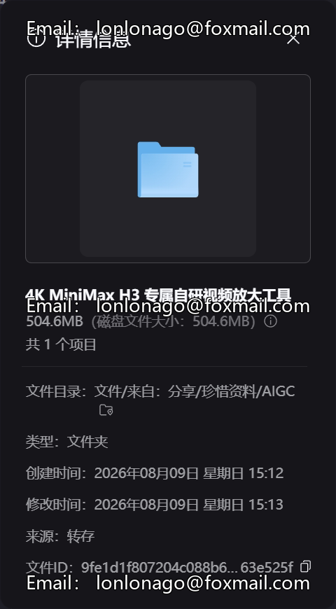

# 4K MiniMax H3 exclusive self-developed video enlargement tool 4K ultra-clear

## Body

4K MiniMax H3 exclusive self-developed video enlargement tool 4K ultra-clear picture quality optimization compatible with all workflows local deployment |

Product Description
This set is a proprietary custom-developed image quality enlargement tool for the MiniMax H3 video model, deeply matching the color and texture characteristics of the H3's native output. It can seamlessly integrate into the H3's entire series of ComfyUI workflows. This tool aims to enhance the image quality of the H3's native maximum 2K output, achieving a 4K ultra-clear enlargement effect. It fixes issues such as blurriness and detail loss in generated videos, and its final product quality matches that of Seedance 2.5's native 4K performance. It is suitable for upgrading the image quality of various content types including short dramas, product videos, etc.

Core features
Exclusive Adaptive Tuning: Developed for the MiniMax H3, this algorithm optimizes the picture generation process specifically. Unlike general super-resolution tools, it seamlessly integrates into workflows such as Wensheng Video, Tusheng Video, and Multi-Reference Generation, with a simple integration process and unified style without fragmentation.
Ultra-clear resolution upgrade: Supports up to 4K horizontal format with lossless enlargement, and vertical content supports 2K ultra-clear output. Intelligently enhances picture texture details, improving the edge blur and material texture issues in native output, thereby enhancing the overall elegance of the final product.
Local offline operation: Supports one-click local deployment, all image processing is completed locally without uploading to the cloud, ensures data security and controllability, with no additional costs for intermittent calls.

All-scene Applicable: Suitable for various creative scenarios such as AI short film quality optimization, enhancing the clarity of product videos, enhancing details in creative content, and upgrading the texture of cinematic scenes.

Delivery Content
MiniMax H3 Exclusive Video Magnification Tool Installation Package
ComfyUI Workflow Access Operations Guide Document
The tools are fully free to use throughout the entire process, with no additional fees.

Run configuration requirements
System: Windows 10 and above versions
Graphics card: Only supports NVIDIA dedicated graphics cards, recommended to have at least 12GB of memory for smooth operation.
Environment: Self-provide MiniMax H3 basic operating environment and ComfyUI framework.

Purchase Notice
This product is a virtual digital resource, and it is replicable. Once shipped, non-file damage issues will not be accepted. Please confirm your hardware configuration and usage requirements before placing an order.
The resources are for personal study and research only. Please comply with relevant laws and regulations and the corresponding open-source model license agreement.
Prohibit secondary resale, splitting and dissemination, and unauthorized commercial use. Infringement will be pursued for related responsibilities.

## Images

## Payment

Here is a pay link on Stripe ( https://buy.stripe.com/3cs8yP7sY87d0vu9AB ). Please contact me lonlonago@foxmail.com after funding $89, and I will send you a complete data files , thank you!

